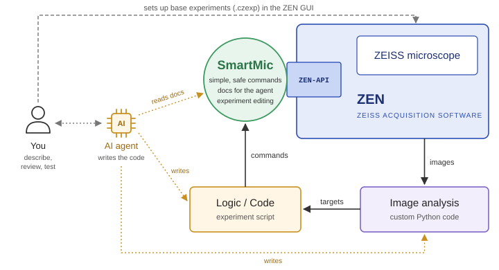

# SmartMic

**Agent-coded smart microscopy on a commercial ZEISS system.**

SmartMic is a Python wrapper around the ZEISS ZEN gRPC API (ZEN-API). It lets an
AI coding agent write smart-microscopy experiments that run unattended on a
ZEISS microscope: the agent is the *developer*, not the runtime. Acquisitions
run as ordinary, deterministic Python scripts that a person has reviewed and
tested on the microscope.

Developed at [ScopeM](https://scopem.ethz.ch), the microscopy core facility of
ETH Zurich.



## Why

Smart microscopy is the combination of real-time analysis, feedback control and
automated actuation (Rates et al., 2026): the microscope looks first, decides,
and then images only what matters. Until recently, building such a loop needed
three things: coding, live image analysis, and remote control of vendor
software that is usually closed.

AI coding agents now handle the first two in hours instead of days, and the
ZEN-API opens ZEN to external control. But the raw API is not a safe place for
an agent to work. It is low-level, and the microscope is a physical device with
hidden dependencies (lowering the objective breaks the immersion), imperfect
hardware (objectives are not perfectly parcentric or parfocal), errors that
aren't errors, and mistakes that are physical (a crashed objective, a bleached
sample).

SmartMic is the guide layer between the agent and the microscope.

## What SmartMic does

- **Drives the microscope reliably** with short, human-readable calls: stage,
  focus (DefiniteFocus, software autofocus), objectives and optovar,
  experiments, tray load and eject. A failed call raises an error instead of
  returning a value that a script could ignore.
- **Checks before it moves.** Arguments are range-checked before any hardware
  call, stage and focus moves are guarded, arrival is confirmed, and every
  call has a time limit.
- **Ships documentation written for the agent.** [`CLAUDE.md`](CLAUDE.md) and
  [`DEV_NOTES.md`](DEV_NOTES.md) record the ZEN and hardware quirks and the
  safety rules the agent reads before it writes code.
- **Edits ZEN experiments** (`.czexp` XML files) for settings the API cannot
  reach, such as positions, tile regions and z-range, and refuses files that
  would be unrunnable or unsafe.
- **Records what produced the data.** Each run can write a version record with
  the SmartMic commit, the ZEN, gateway and `zen_api` versions, and the
  commits of the project and analysis repositories.

## How a project works

1. **You set up the base experiments in the ZEN GUI**: channels, lasers,
   detectors, objectives. Imaging settings stay with you, in software you
   already know. SmartMic later changes only what the run needs (positions,
   tiles, z-range).
2. **You describe the experiment** to the agent (we use Claude, by Anthropic),
   with a few example images.
3. **The agent writes the experiment script and the image analysis**, using
   SmartMic and its docs.
4. **You review the code and test it on the microscope**, with a person present,
   before any unattended run.

Projects are usually one-off: set up for one user's question, run, then
retired. Code that turns out to be generally useful is moved into SmartMic.
Image analysis lives in separate repositories with their own environments (see
[Image analysis](#image-analysis)).

## Applications so far

All on a ZEISS Celldiscoverer 7 at ScopeM. The project code is kept outside
this repository.

| Application | Pipeline | Setup | Imaging | Imaged |
|---|---|---|---|---|
| Spheroid scan (flat-bottom 96-well plates) | 5× widefield overview → 20× fast z-stack, bounding-box fit → 20× confocal z-stack of the box only | 6 h | 48 h | 200+ spheroids |
| Single-cell Airyscan (ibidi 8-well slides) | 5× widefield overview, pick nuclei → recentre at 40× → short confocal stack, find mid-plane → one Airyscan plane per cell | 2 h | 30 h | 2000+ cells |
| U-bottom spheroid scan (96-well U-bottom plates) | focus from a 2.5× brightfield z-sweep → find spheroid → 10× fast LSM stack, box fit → 10× LSM of the box | 5 h | 42 h | 170+ spheroids |

"Setup" is the time from idea to a running pipeline. None of these unattended
runs crashed.

## Status and limitations

SmartMic is research software in active development. Please read this before
you use it.

- **Tested on one microscope model.** Every project so far ran on a single
  ZEISS Celldiscoverer 7 (inverted, with a 50× water-immersion objective).
  Other ZEN-controlled systems should work in principle but are untested, and
  some safety constants (optics, carriers, immersion handling) are specific to
  this setup.
- **Tested on one software version:** ZEN (blue) 3.13 (3.13.109), ZenApiGateway
  3.6.25262, `zen_api` stubs matching ZEN-API package 2025.10.1. ZEISS publishes
  separate `zen_api` packages for ZEN 3.14 and 3.15; SmartMic has not been
  tested with them.
- **Windows only.** The pixi environment is defined for `win-64`, because ZEN
  runs on Windows.
- **It drives real hardware.** A wrong script can crash an objective, break the
  immersion or bleach a sample. Review every script, run it with someone
  present first, and use it at your own risk (see [License](#license)).
- **Code written by an AI agent.** Most of the code was written by Claude under
  human direction. It is reviewed and tested on the microscope, but the agent
  makes mistakes, and review is what catches them.
- **Base experiments are made by hand** in the ZEN GUI; SmartMic does not
  create acquisition settings from scratch.
- **Not everything is reachable through the ZEN-API.** For example, the
  auto-immersion settings can only be read from ZEN's own files. See
  `DEV_NOTES.md`.
- **No releases yet.** The API can still change. Each run logs the exact
  SmartMic commit.
- **Not a ZEISS product.** SmartMic is independent of and not endorsed by Carl
  Zeiss AG.

## Requirements

- A ZEISS microscope controlled by ZEN (blue) with the ZEN-API gateway running
  (ZEN-API needs ZEN 3.11 or later; SmartMic was tested on 3.13), and a ZEN-API
  control token.
- The ZEISS `zen_api` Python package, from the
  [ZEISS OAD repository](https://github.com/zeiss-microscopy/OAD/tree/master/ZEN-API).
  It is not included here.
- [pixi](https://pixi.sh) to install the Python environment.
- An AI coding agent to write experiments (optional, but this is the point).

## Setup

**1. Clone SmartMic and install the environment.**

    git clone https://github.com/Mike587/SmartMic.git
    cd SmartMic
    pixi install -e smartmic

`smartmic` = the library + the few extras the local projects use (scipy,
matplotlib, opencv, …). `default` is the bare library + tests (`pixi run test`).
Image analysis has its own envs in the `ia_*` repos (see below).

**2. Make the ZEISS `zen_api` package findable.** `zeiss_paths.py` adds the ZEISS
folder to `sys.path` when it is imported, so every module that uses `zen_api`
imports `zeiss_paths` first. It looks in the ZEN-API `python_examples` folder,
by default:

    C:/Users/zeiss/Zeiss_OAD/OAD/ZEN-API/python_examples

and in the versioned packages next to it, `ZEN-API/python_packages/zen_api-<version>/src`
(`python_package/` in older OAD checkouts; both names are searched). The
simplest way to get them is to clone the
[ZEISS OAD repository](https://github.com/zeiss-microscopy/OAD) to
`C:/Users/zeiss/Zeiss_OAD/OAD`. If your copy is somewhere else, set:

    SMARTMIC_ZEISS_EXAMPLES=<path-to-ZEN-API/python_examples>

To pin one of several package versions, set `SMARTMIC_ZEN_API_VERSION` (for
example `2025.10.1`).

**3. Create `config.ini`.** The connection settings hold a machine-specific
control token (a secret), so `config.ini` is git-ignored. Copy the template:

    copy config.ini.example config.ini

and fill it in:

    [api]
    host = 127.0.0.1
    port = 5002
    cert_file = C:\ProgramData\Carl Zeiss\ZenApiGateway\Certificates\ZenApiPersonalSigningRootCA.pem
    control-token = <paste-your-ZEN-API-control-token-here>

The control token is issued by the ZEN-API gateway. Never commit `config.ini`.

**4. Check the connection** (read-only, moves nothing):

    pixi run -e smartmic python verify_zen_api.py

It imports every module and makes a few read-only queries (carrier, objective,
stage and Z position). Run it again after any ZEN or `zen_api` update.

Other optional environment variables: `SMARTMIC_OUTPUT_ROOT` (default output
folder), `SMARTMIC_ROOT` (repo location for project scripts),
`SMARTMIC_ZEN_LOGGING_DIR` and `SMARTMIC_ZEN_API_GATEWAY_EXE` (if ZEN is not
installed in the standard location).

## Running

A project script imports the synchronous entry point and calls plain functions:

```python
import MS_CD7_API_LoA as ms
from MS_run_log import setup_run_logger, write_run_info

log, log_file = setup_run_logger()
write_run_info(log_file, log)                         # versions of everything in use
ms.preflight("Multichamber 384", log)                 # expected carrier; raises on failure
x, y = ms.get_current_xy_stage_position()             # metres
```

Lengths are in metres throughout; `.czexp` and `.czi` files store µm, and
conversion happens only at that boundary.

The bundled proof of concept (`projects/smartmic_poc`: overview → nuclei →
confocal z-stacks at a few of them, on a Multichamber 384) runs with:

    pixi run -e smartmic poc         # on the scope
    pixi run -e smartmic test-poc    # offline dry run with a fake microscope

## Testing

Two tiers: fast offline unit tests, and hardware tests that run against the live
ZEN-API with a 384-well plate loaded. Hardware tests are skipped unless you pass
`--run-hardware`, so a plain run never moves the microscope.

    pixi run -e smartmic test        # offline unit tests
    pixi run -e smartmic test-hw     # hardware tests (on the microscope, opt-in)

See [`tests/README.md`](tests/README.md) for the safe order to run the hardware
tiers, and [`tests/TEST_PLAN.md`](tests/TEST_PLAN.md) for the design.

## Repository layout

The repo root holds the reusable library; example pipelines live under
`projects/`, one folder each.

| File | Role |
|------|------|
| `MS_CD7_API_LoA.py` | Synchronous entry point: wraps the async ZEN gRPC calls and adds checks and guards |
| `MS_zenapi_focus.py` | DefiniteFocus / FocusService (Z-drive) |
| `MS_zenapi_swaf.py` | Software autofocus |
| `MS_zenapi_objectivechanger.py` | Objective and optovar |
| `MS_zenapi_stage_LM.py` | XY stage |
| `MS_zenapi_sample_carrier.py` | Sample-carrier info; container (slide position) moves |
| `MS_zenapi_live_scan.py` | Tray load / eject and prescan configuration (use the guarded versions in `MS_CD7_API_LoA.py`) |
| `MS_zenapi_experiment_methods.py` | Run a `.czexp` by path; status / stop of a running experiment |
| `MS_czexp_editor.py` | Read and modify `.czexp` files (positions, z-stack, scan crop); refuses unrunnable or unsafe files |
| `MS_limits.py` | Range checks for positions and changer numbers |
| `MS_run_log.py` | Run log, per-run version record, JSONL records, default output folder |
| `MS_metadata.py` | Positions and sample carrier from a `.czexp`; carrier check (CZI reading: ia_common) |
| `MS_image_analysis.py` | Launches external image-analysis scripts; reads back their results |
| `MS_zen_logs.py` | Facts the API does not give, read from ZEN's log and options files |
| `MS_zenapi_helpers.py` | Vendored ZEN-API glue: channel setup with call time limits, logging, objective lookups |
| `zeiss_paths.py` | Path bootstrap and version identities (SmartMic, ZEN, gateway, `zen_api`) |
| `verify_zen_api.py` | Read-only connection check |
| `projects/smartmic_poc/` | Proof-of-concept pipeline; the reference layout for a project |

Project scripts find the library through the `SMARTMIC_ROOT` environment
variable (default: the standard checkout location), so a project can live
anywhere on disk. `config.ini` stays at the repo root and is shared by all
projects.

## Image analysis

Analysis code lives in separate, self-contained repositories, each with its own
pixi environment, so its dependencies never conflict with the ZEN-API
environment. `MS_image_analysis.py` runs such a project as a subprocess: it
passes a CZI, an output folder and a `--prefix`, and
`run_analysis_json` reads back `<prefix>_<suffix>.json`. Analyses are built on
[Mike587/ia_common](https://github.com/Mike587/ia_common) (CZI reading, pixel ↔
stage, and this script contract; start from its `templates/analyze_template.py`).
The PoC's analysis, [Mike587/ia_PoC_004](https://github.com/Mike587/ia_PoC_004),
is the reference example: nuclei → `<prefix>_targets.json` with stage positions.

## Citing SmartMic

A preprint is in preparation. Until then, please cite this repository and the
LM User Day 2026 talk "Agent-Coded Smart Microscopy" (M. Stebler, ScopeM, ETH
Zurich, 4 November 2026).

Background on smart microscopy:

- Rates A, Passmore JB, Norlin N, Kapitein LC. Smart microscopy: adaptive
  microscope control to improve the way we see life. *npj Imaging* 4, 14
  (2026). doi:10.1038/s44303-026-00145-y
- Hinderling L et al. Smart microscopy: current implementations and a roadmap
  for interoperability. *Methods in Microscopy* (2026).
  doi:10.1515/mim-2025-0029

## Acknowledgements

Marc Alexander Höll and Markus Stoffel (IMHS, ETH Zurich) for the spheroid
projects; Sebastian Rhode (ZEISS) for the ZEN-API and its example code; Claude
(Anthropic), the AI agent that wrote most of the code; and the ScopeM team.

Contact: Michael Stebler, ScopeM, ETH Zurich, michael.stebler@scopem.ethz.ch.
If you would like to run your experiment with SmartMic, get in touch.

## License

SmartMic is released under the [MIT License](LICENSE), © 2026 ETH Zurich
(ScopeM). It comes without warranty of any kind.

Some `MS_zenapi_*` modules are derived from the ZEISS ZEN-API example scripts
and keep their original `Copyright(c) 2025 Carl Zeiss AG` header and permission
notice, as ZEISS's grant requires. Those notices stand alongside the MIT
license; keep them in any derivative.
